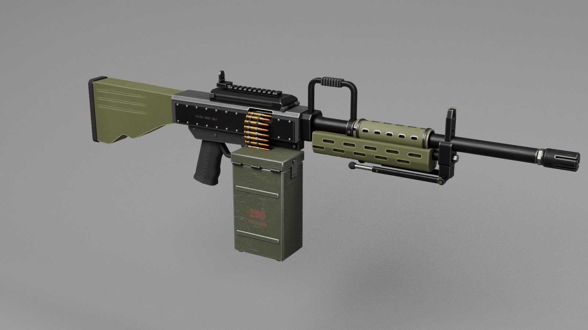
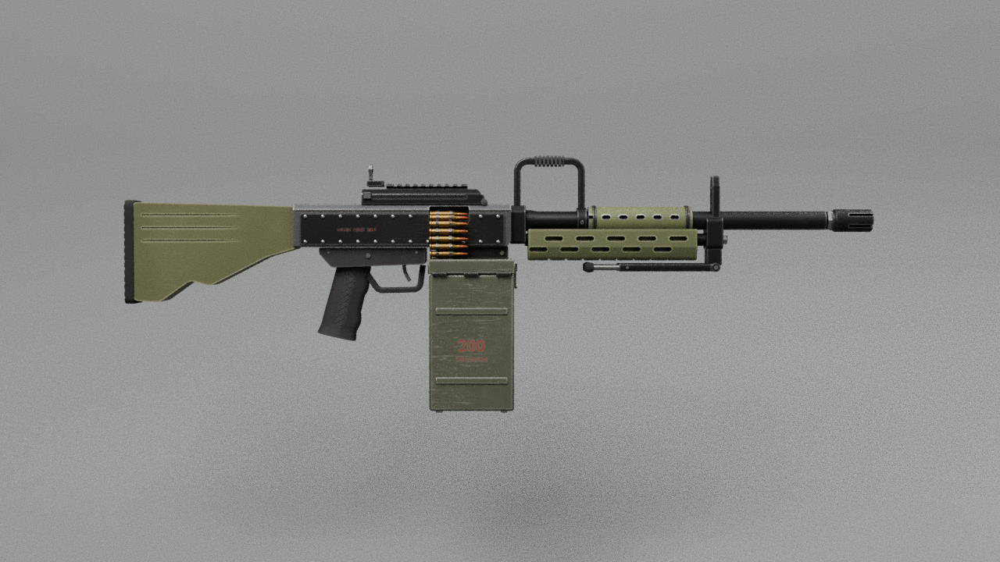
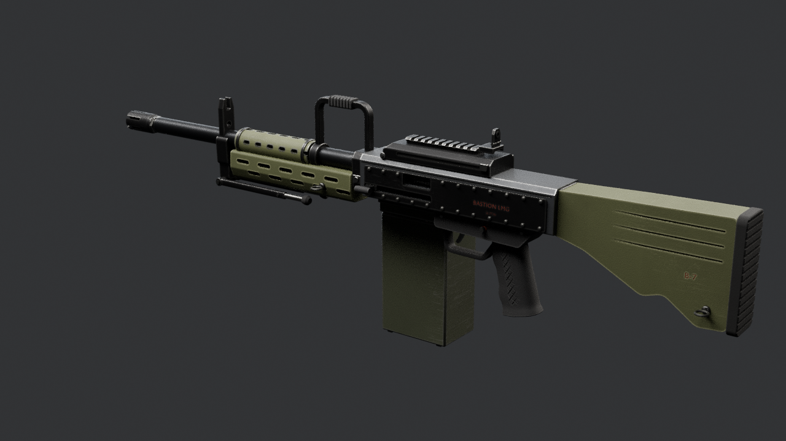

# Bastion LMG — Roblox handoff package

> **To the Roblox coding chat:** this folder is a complete, self-describing model package from Nic's Blender pipeline. Everything you need to make the model *fully functional and realistic* in Survival Island is here: the mesh file, every moving part with its exact hinge and motion, seats, sockets, lights, collision proxies, physics data and gameplay rules. The machine-readable source of truth is `BastionLMG_Rig.json` (schema `survival-island-model/1`); this file explains it. Please read sections 3–4 before writing code.

**Bastion LMG** · category: **weapon** · belt-fed light machine gun with a carry handle, side ammo box and folding bipod

## 1. Files
| File | What |
|---|---|
| `BastionLMG.fbx` | 32 meshes, 42938 triangles (largest 9322 — under Roblox's 20k limit), already in studs |
| `BastionLMG_Rig.json` | all data below, machine-readable |
| `BastionLMG_HANDOFF.md` | this guide |
| `previews/` | renders at rest and deployed |

## 2. Import into Studio
3D Importer (Home → Import / Avatar → Import 3D / File → Import 3D / Ctrl+M) with: **Scale Unit = Stud, Scale Factor = 1, World Forward = Front, World Up = Top, Set Pivot to Scene Origin ✔, Upload to Roblox ✔**.
Expected File Dimensions ≈ **0.77 × 1.68 × 5.00** studs (X × Y × Z). The import is a flat Model of MeshParts that are all grey/white, anchored-or-unanchored, unwelded and fully collidable — your setup code must fix that (§4).
Bounding-box centre after a correct import: `(0.11, -0.40, -0.64)` — use it to re-align the model if a different pivot option was used (`shift = expected_center − actual_center`).

## 3. Coordinates, units, names
- **1 stud = 0.28 m.** All `*_studs` values in the JSON are final Roblox numbers.
- Model space: origin on the bore axis directly above the trigger (all five weapons share this datum), **front = −Z (LookVector)**, up = +Y, **the model's RIGHT = +X**, its left = −X. (Blender source: front −Y, left +X; converted for you.)
- Mesh names: `RBX_<Group>_<Material>[_n]`. `<Group>` is either `Body` (static) or a moving group from §5. Group names contain underscores, so match them against the JSON `groups` keys (longest match first); `<Material>` has no digits; `_n` is a chunk index for big meshes.
- Every moving group's meshes were exported with the MeshPart pivot on the group's hinge, but Roblox recentres MeshParts — always use `pivot_studs` from the JSON, never the MeshPart position.

## 4. Recommended assembly (Roblox `Tool`)
1. Put every MeshPart in a **`Tool`**. Add an invisible, unanchored **`Handle`** part (about 0.4 × 0.4 × 0.4 studs, `CanCollide = false`) centred on point `BLMG_Grip_Right` (§8). Set `Tool.Grip` so that point sits in the character's right hand. The weapon then points along the HumanoidRootPart LookVector, because the muzzle is −Z.
2. Static meshes (`RBX_Body_*`): `WeldConstraint` to the Handle. Visual parts: `CanCollide = CanTouch = CanQuery = false`, `Massless = true`, materials from §11 (or the SurfaceAppearance of §15).
3. **One Motor6D per moving group** (§5): Part0 = the parent group's joint (or the Handle for `parent_group = Body`), Part1 = an invisible joint part at `pivot_studs` (identity rotation); weld the group's meshes to that joint part. Create parents first (e.g. a bolt before its handle).
4. Animate on the client with `Motor6D.Transform` (`rotate` → `CFrame.fromAxisAngle(axis, math.rad(open * eased_progress))`, `translate` → `CFrame.new(axis * studs * eased_progress)`). Use the channels in §6: play `Cycle` 0→1→0 once per shot at the `rpm` of §12, `Trigger` while the button is held, `Reload` / `Charge` / covers in the order given in the channel rules. The server owns ammo, fire rate and hit detection.
5. Attachments at the points of §8: `Muzzle` (raycast origin + direction, flash, smoke), `Ejection` (shell casing emitter, direction given), `Aim` (camera position for aiming down sights), `Grip_Left` (support hand IK target), `MagWell` (where a new magazine enters).
6. Hide / show a group (e.g. the magazine during reload) by setting `LocalTransparencyModifier` on its meshes; groups of `kind = store` are meant to be hidden and shown like that.

## 5. Moving parts
Axes are the joint frame (= model axes at rest). An axis is a letter (X / Y / Z) or a unit vector `(x, y, z)` in model space for hinges that are not on a model axis — rotate about it with `CFrame.fromAxisAngle(axis, math.rad(angle))`. `open` is the value at channel state 1; `stage` is the slice of the channel's 0→1 progress during which this part moves (ease each slice with smoothstep). Types: rotate / translate (channel-driven), aim_yaw / aim_pitch / steer / control (player input, clamp to min..max), spin (continuous while its channel > 0), wheel (rolls on the ground), fixed (rides on its parent; `store` = a weapon that can be hidden / released).

| Group | Parent | Pivot (studs) | Motion | Channel · stage | What it is |
|---|---|---|---|---|---|
| `BLMG_AmmoBox` | Body | (0.28, -0.26, -0.46) | slide -0.6429 studs along Y | Reload · 0.3–1 | ammo box: unlatches from its mount and drops 0.18 m (stage 0.3-1, after the feed cover is open) |
| `BLMG_AmmoBox_Lid` | BLMG_AmmoBox | (0.48, -0.35, -0.46) | rotate -100 deg about Z | BoxLid · 0–1 | ammo box lid: swings 100 deg outward on its hinge to refill the box |
| `BLMG_Belt_Cartridges` | Body | (0.16, -0.07, -0.30) | fixed to its parent (store: belt) | — | decorative linked belt (8 rounds): hide it while the feed cover is open / during reload |
| `BLMG_BipodLeg_L` | Body | (-0.10, -0.31, -2.08) | rotate +90 deg about X | Bipod · 0–1 | bipod leg: folded back under the handguard; swings 90 deg down to deploy |
| `BLMG_BipodLeg_R` | Body | (0.10, -0.31, -2.08) | rotate +90 deg about X | Bipod · 0–1 | bipod leg: folded back under the handguard; swings 90 deg down to deploy |
| `BLMG_Bolt` | Body | (-0.00, -0.01, -0.39) | slide +0.25 studs along Z | Cycle · 0–1 | bolt: recoils 0.070 m and returns per shot (visible through the left ejection port) |
| `BLMG_ChargingHandle` | Body | (-0.16, -0.10, -0.62) | slide +0.4214 studs along Z | Charge · 0–1 | charging handle (left): pulled 0.118 m back to cock the open bolt, then pushed forward again |
| `BLMG_FeedCover` | Body | (-0.00, 0.12, -0.54) | rotate -80 deg about X | FeedCover · 0–1 | feed cover: hinged at its front, lifts 80 deg to lay a new belt on the feed tray |
| `BLMG_Safety` | Body | (-0.01, -0.24, 0.24) | slide -0.0286 studs along X | Safety · 0–1 | cross-bolt safety: pushed 8 mm from left to right = FIRE (red band shows); rest = SAFE |
| `BLMG_Trigger` | Body | (-0.00, -0.26, -0.01) | rotate -14 deg about X | Trigger · 0–1 | trigger: 14 deg rearward; hold = automatic fire |

## 6. Channels (states the server owns)
| Channel | Duration 0→1 | Moves | Rules |
|---|---|---|---|
| `Trigger` | 0.05 s | `BLMG_Trigger` | — |
| `Cycle` | 0.05 s | `BLMG_Bolt` | — |
| `Charge` | 0.40 s | `BLMG_ChargingHandle` | — |
| `Safety` | 0.10 s | `BLMG_Safety` | — |
| `FeedCover` | 0.50 s | `BLMG_FeedCover` | reload order: FeedCover 1 -> hide BLMG_Belt -> Reload 1 (box drops) -> Reload 0 (new box) -> show BLMG_Belt -> FeedCover 0 -> Charge 1 -> 0 |
| `Reload` | 1.20 s | `BLMG_AmmoBox` | — |
| `BoxLid` | 0.40 s | `BLMG_AmmoBox_Lid` | — |
| `Bipod` | 0.60 s | `BLMG_BipodLeg_L`, `BLMG_BipodLeg_R` | deployed: prone / rested fire with much less spread |

## 6b. Named poses (flight modes / test states)
| Pose | Channels at 1 | Inputs | On the ground | What it is |
|---|---|---|---|---|
| `fire` | Trigger=1, Cycle=1, Safety=1, Bipod=1 | — | no | bipod down, firing |
| `reload` | FeedCover=1, Reload=1, BoxLid=1 | — | no | feed cover open, box off with lid open |
| `charge` | Charge=1, Cycle=1 | — | no | charging handle and bolt back |

## 8. Points / sockets
| Point | Position (studs) | Attached to | Purpose |
|---|---|---|---|
| `BLMG_Muzzle` | (-0.00, 0.00, -3.14) | Body | muzzle (direction=[-0.0, 0.0, -1.0], note=bullet origin + muzzle flash (long 6-prong flash hider)) |
| `BLMG_Ejection` | (-0.17, -0.00, -0.25) | Body | ejection (direction=[-0.9126, 0.3758, 0.161], note=spent cases leave the LEFT ejection port; links drop below) |
| `BLMG_BeltFeed` | (0.17, 0.04, -0.30) | Body | belt_feed (direction=[-1.0, 0.0, 0.0], note=belt enters the feed tray (right side)) |
| `BLMG_Grip_Right` | (-0.00, -0.54, 0.41) | Body | grip_right (note=firing hand on the pistol grip) |
| `BLMG_Grip_Left` | (-0.00, -0.26, -1.50) | Body | grip_left (note=support hand under the handguard (or on the carry handle)) |
| `BLMG_Carry` | (-0.00, 0.42, -0.97) | Body | carry_handle (note=hand position when carrying the gun one-handed) |
| `BLMG_Aim` | (-0.00, 0.32, 0.54) | Body | aim_eye (direction=[-0.0, 0.0, -1.0], note=eye position behind the aperture rear sight) |
| `BLMG_BipodFeet` | (-0.00, -1.19, -2.08) | Body | bipod_contact (note=feet contact point with Bipod = 1) |
| `BLMG_Sling_Front` | (-0.18, -0.18, -1.07) | Body | sling |
| `BLMG_Sling_Rear` | (-0.19, -0.43, 1.68) | Body | sling |

## 11. Materials (apply by the `<Material>` part of each mesh name)
| Material | Roblox material | Colour (RGB) | Transparency | Reflectance |
|---|---|---|---|---|
| Blackened | Metal | 38, 38, 40 | 0 | 0 |
| Brass | Metal | 136, 110, 66 | 0 | 0 |
| Copper | Metal | 140, 90, 62 | 0 | 0 |
| DarkSteel | Metal | 52, 53, 56 | 0 | 0 |
| Graphite | Metal | 74, 76, 80 | 0 | 0 |
| MarkRed | SmoothPlastic | 118, 50, 38 | 0 | 0 |
| PaintOlive | SmoothPlastic | 86, 90, 62 | 0 | 0 |
| PaintOliveDark | SmoothPlastic | 60, 64, 50 | 0 | 0 |
| PolyBlack | Plastic | 34, 34, 36 | 0 | 0 |
| PolyOlive | Plastic | 76, 80, 54 | 0 | 0 |
| Rubber | Rubber | 30, 30, 30 | 0 | 0 |
| Steel | Metal | 128, 128, 125 | 0 | 0 |

## 12. Gameplay systems
### Weapon
- **kind:** light machine gun (belt fed, open bolt)
- **caliber:** 7.8x51 mm (fictional)
- **magazine:** 200
- **feed:** linked belt from the side ammo box
- **fire modes:** ['SAFE', 'AUTO']
- **rpm:** 750
- **muzzle velocity mps:** 840
- **effective range studs:** 2143
- **reload s:** 5.5
- **damage hint:** medium-high
- **recoil hint:** heavy, sustained climb; much lower on the bipod
- **aim:** aperture rear on the feed cover + tower front
- **movement hint:** slow while carried; very slow while firing standing
- **ammo item:** AmmoBelt_7.8x51

## 13. Notes and rules
- Weapon origin = bore axis above the trigger; the muzzle points -Z in Roblox (LookVector).
- BLMG_Belt is a decorative 8-round belt (kind=store): hide it during reload, show it when the box is back.

## 14. Acceptance checklist (test in Studio before calling it done)
- [ ] Import size matches §2; installer reports 0 unknown mesh names.
- [ ] Every group in §5 moves about the right hinge, in the right direction, by the listed amount, in stage order.
- [ ] Nothing floats or clips at rest **and** fully deployed (the Blender checks found 0 floating parts in both).
- [ ] All server checks in place (who may use what, rate limits, clamped inputs) — the game is server-authoritative.
- [ ] Output window clean (no errors/warnings from the new scripts).

_Generated 2026-10-15 17:08 by the handoff exporter (`blender/common/handoff.py`). FBX re-import check: PASSED (10 pivots compared, 0 problems)._

## 15. Baked texture atlas (optional, recommended)
All meshes of this weapon share ONE UV layout, so one `SurfaceAppearance` (cloned into every MeshPart) gives the worn, weathered look from the Blender renders (edge wear, scratches, grime, dark recesses, red markings):

| Map | File | Colour space |
|---|---|---|
| ColorMap | `textures/BastionLMG_BaseColor.png` | sRGB |
| RoughnessMap | `textures/BastionLMG_Roughness.png` | linear |
| MetalnessMap | `textures/BastionLMG_Metalness.png` | linear |

Upload the three PNGs (Asset Manager > Bulk Import), create a SurfaceAppearance with the three IDs, and parent a clone to each MeshPart. With a SurfaceAppearance the MeshPart `Color` is ignored; without it, use the flat colours of section 11.

## 16. Previews
  

Pose previews (moving parts deployed): `previews/BastionLMG_pose_*.png`.
