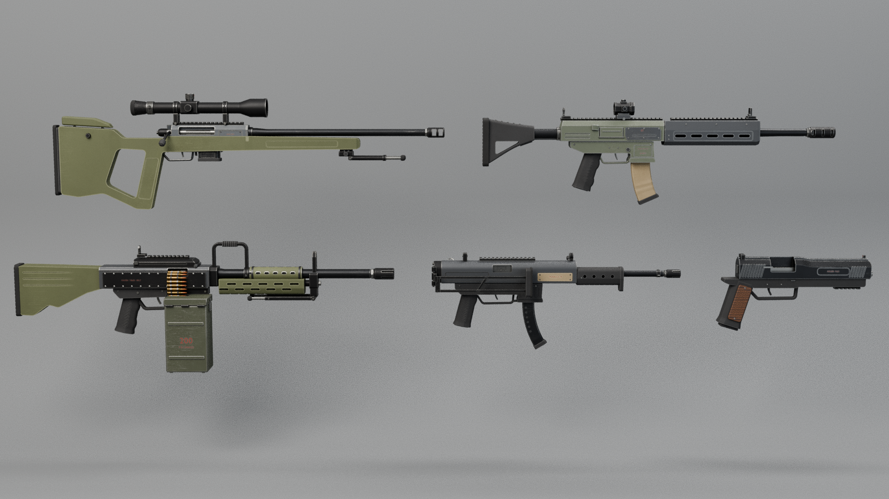

# Survival Island — weapon pack (5 weapons)

Five original survival-game weapons for **Survival Island**. Built 100 % from Python scripts in Blender 5.2.2
(`blender/weapons/`), checked automatically, exported for Roblox and rendered.



| Weapon | Blender collection | FBX | Size in studs (L × H × W) | Requested | Triangles | Export meshes | Moving parts |
|---|---|---|---|---|---|---|---|
| **Roadrunner R-12** — scavenger carbine | `ROADRUNNER_R12` | `RoadrunnerR12.fbx` | 4.60 × 1.38 × 0.42 | 4.6 × 1.4 × 0.6 | 37,200 | 25 | magazine, bolt, charging handle, trigger, selector, dust cover, 2 flip sights, adjustable stock |
| **Mako-9** — compact SMG | `MAKO9` | `Mako9.fbx` | 3.30 × 1.30 × 0.53 | 3.3 × 1.35 × 0.55 | 30,286 | 17 | magazine, bolt, cocking handle, trigger, selector, side-folding stock |
| **Trailmark .308** — marksman rifle | `TRAILMARK_308` | `Trailmark308.fbx` | 5.10 × 1.51 × 0.49 | 5.1 × 1.55 × 0.6 | 34,172 | 27 | bolt (slides) + bolt handle (lifts), magazine, trigger, safety, 2 bipod legs, cheek riser, scope zoom ring |
| **Sparrow-9** — pistol | `SPARROW9` | `Sparrow9.fbx` | 2.04 × 1.02 × 0.26 | 2.0 × 1.0 × 0.45 | 21,442 | 13 | slide, trigger, magazine |
| **Bastion LMG** — belt-fed machine gun | `BASTION_LMG` | `BastionLMG.fbx` | 5.00 × 1.68 × 0.77 | 5.0 × 1.8 × 0.75 | 42,938 | 32 | feed cover, bolt, charging handle, trigger, safety, ammo box + lid, belt, 2 bipod legs |

Lengths match the request exactly, and heights are within ±7 %.
Widths are 70–103 % of the request; the pistol is 58 %. Widths stay at believable, slightly chunky proportions on
purpose, because a 0.45-stud-wide pistol would be twice as fat as a real one.
All relative rules from the brief pass (`qa_report.json`):
- the pistol is the smallest;
- the SMG is more compact than the carbine;
- the marksman rifle is the longest and slimmest;
- the LMG is the broadest.

## Files

| File | What |
|---|---|
| `SurvivalWeaponPack.blend` | the editable source: parent collection `SURVIVAL_WEAPONS` with one collection per weapon, `PRESENTATION` collection (backdrop, key / fill / rim / top lights, `CAM_Lineup`, `CAM_<CODE>_34` close-up cameras), baked textures packed inside, build scripts stored as text blocks |
| `<Name>.fbx` | one weapon per file, in **studs**, exported with *FBX Unit Scale* applied, **Z forward, Y up** |
| `<Name>_Rig.json` | machine-readable rig: every moving part's pivot + motion, muzzle / ejection / grip / aim points, materials, fire modes |
| `<Name>_HANDOFF.md` | step-by-step guide for the Roblox coding chat (import, assembly, animation, textures) |
| `textures/<Name>_BaseColor / _Roughness / _Metalness.png` | baked 2048² atlas per weapon (verified: `previews/bake_check_<Name>.png`) |
| `SurvivalWeaponPack_Lineup.png`, `<Name>_34.png` | combined preview + three-quarter close-ups |
| `previews/` | right side, rear three-quarter, moving-part poses, bake checks |
| `qa_report.json`, `export_summary.json` | automated check results (floating parts, clashes, holes, sizes, FBX re-import) |

## Shared conventions (all five)
- **Origin = the same datum on every weapon:** on the bore axis, directly above the trigger. All static parts share
  it (transforms applied); moving parts have their origin on their real hinge / slide pivot.
- Blender: metres, Z up, muzzle → −Y, weapon's left = +X. Roblox (after import): studs, muzzle → **−Z (LookVector)**,
  up +Y. 1 stud = 0.28 m.
- Object names `<CODE>_<Part>` (e.g. `R12_Receiver_Upper`, `TM308_Scope_TurretElevation`, `BLMG_AmmoBox_Lid`).
  The FBX merges parts per (moving group, material): `RBX_<Group>_<Material>` (e.g. `RBX_R12_Magazine_PolyTan`).
- One material library for the pack (`SW_*`): painted olive / olive-gray / slate / dark-olive metal, graphite,
  dark steel, blackened steel, bare steel, black / tan / olive polymer, rubber, dark walnut, brass, copper, faded
  rust-red markings, lens glass. Each is a Principled BSDF with procedural edge wear, scratches, grime, fading and darker recesses.
  Each material also carries an explicit Roblox look (material + RGB) in the rig JSON.

## Import into Roblox Studio
3D Importer → `<Name>.fbx` → **Scale Unit = Stud, Scale Factor = 1, World Forward = Front, World Up = Top**,
Set Pivot to Scene Origin ✔. Then follow `<Name>_HANDOFF.md` (weld the static meshes, one Motor6D per moving
group at its `pivot_studs`, optional SurfaceAppearance from `textures/`).

## Rebuild / check / bake / export / render (cloud Blender)
```
bpy-run blender/build_weapons.py            # builds all five + studio + UVs -> weapon_output/SurvivalWeaponPack.blend (~17 s)
bpy-run blender/check_weapons.py            # floating parts, clashes in every pose, holes, hygiene, sizes -> qa_report.json
bpy-run blender/bake_weapons.py             # 2048² BaseColor / Roughness / Metalness atlases -> textures/ (packed)
bpy-run blender/verify_bake.py              # procedural vs baked-only renders -> previews/bake_check_*.png
bpy-run blender/export_weapons.py           # FBX + rig JSON + handoff guide per weapon, verified by re-import
bpy-run blender/render_weapons.py weapon_output/SurvivalWeaponPack.blend OUT/ "lineup;R12:34;BLMG:right" 1600 64
```
