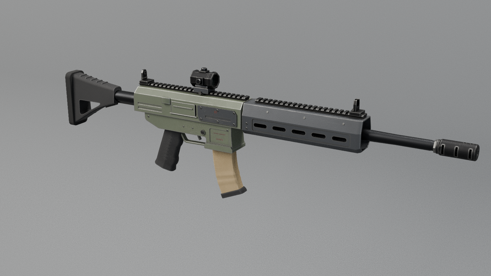
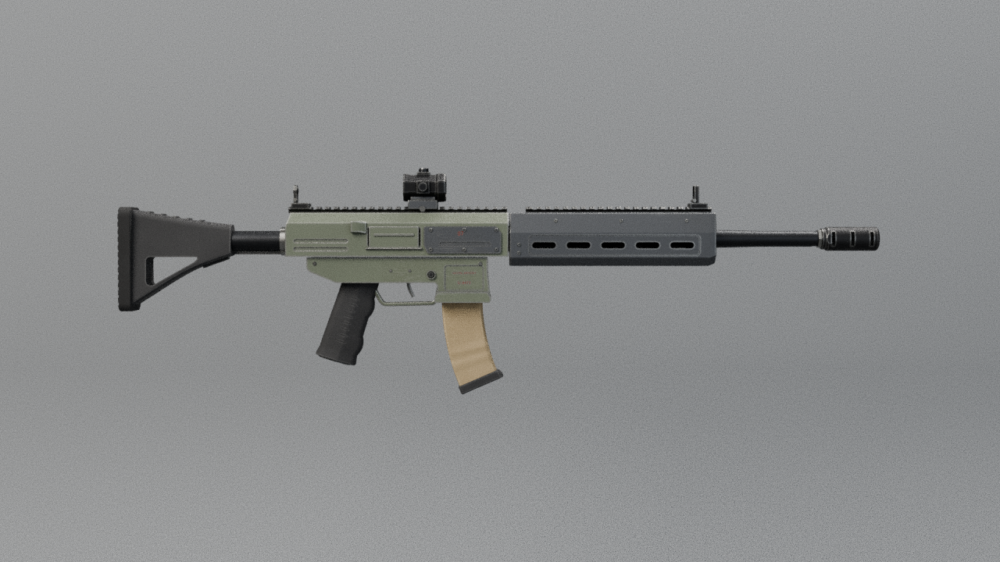
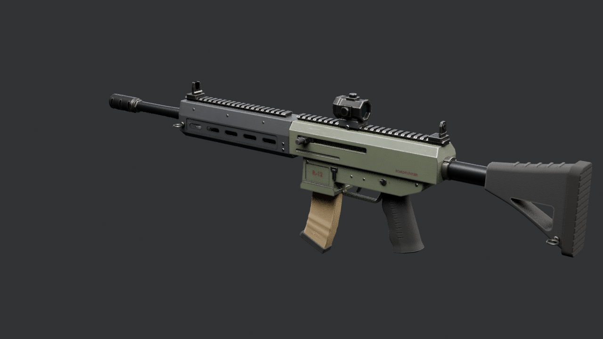

# Roadrunner R-12 — Roblox handoff package

> **To the Roblox coding chat:** this folder is a complete, self-describing model package from Nic's Blender pipeline. Everything you need to make the model *fully functional and realistic* in Survival Island is here: the mesh file, every moving part with its exact hinge and motion, seats, sockets, lights, collision proxies, physics data and gameplay rules. The machine-readable source of truth is `RoadrunnerR12_Rig.json` (schema `survival-island-model/1`); this file explains it. Please read sections 3–4 before writing code.

**Roadrunner R-12** · category: **weapon** · scavenger carbine built from salvaged rifle parts: olive-gray receiver, curved tan magazine, red-dot optic

## 1. Files
| File | What |
|---|---|
| `RoadrunnerR12.fbx` | 25 meshes, 37200 triangles (largest 7674 — under Roblox's 20k limit), already in studs |
| `RoadrunnerR12_Rig.json` | all data below, machine-readable |
| `RoadrunnerR12_HANDOFF.md` | this guide |
| `previews/` | renders at rest and deployed |

## 2. Import into Studio
3D Importer (Home → Import / Avatar → Import 3D / File → Import 3D / Ctrl+M) with: **Scale Unit = Stud, Scale Factor = 1, World Forward = Front, World Up = Top, Set Pivot to Scene Origin ✔, Upload to Roblox ✔**.
Expected File Dimensions ≈ **0.42 × 1.38 × 4.60** studs (X × Y × Z). The import is a flat Model of MeshParts that are all grey/white, anchored-or-unanchored, unwelded and fully collidable — your setup code must fix that (§4).
Bounding-box centre after a correct import: `(-0.04, -0.26, -0.56)` — use it to re-align the model if a different pivot option was used (`shift = expected_center − actual_center`).

## 3. Coordinates, units, names
- **1 stud = 0.28 m.** All `*_studs` values in the JSON are final Roblox numbers.
- Model space: origin on the bore axis directly above the trigger (all five weapons share this datum), **front = −Z (LookVector)**, up = +Y, **the model's RIGHT = +X**, its left = −X. (Blender source: front −Y, left +X; converted for you.)
- Mesh names: `RBX_<Group>_<Material>[_n]`. `<Group>` is either `Body` (static) or a moving group from §5. Group names contain underscores, so match them against the JSON `groups` keys (longest match first); `<Material>` has no digits; `_n` is a chunk index for big meshes.
- Every moving group's meshes were exported with the MeshPart pivot on the group's hinge, but Roblox recentres MeshParts — always use `pivot_studs` from the JSON, never the MeshPart position.

## 4. Recommended assembly (Roblox `Tool`)
1. Put every MeshPart in a **`Tool`**. Add an invisible, unanchored **`Handle`** part (about 0.4 × 0.4 × 0.4 studs, `CanCollide = false`) centred on point `R12_Grip_Right` (§8). Set `Tool.Grip` so that point sits in the character's right hand. The weapon then points along the HumanoidRootPart LookVector, because the muzzle is −Z.
2. Static meshes (`RBX_Body_*`): `WeldConstraint` to the Handle. Visual parts: `CanCollide = CanTouch = CanQuery = false`, `Massless = true`, materials from §11 (or the SurfaceAppearance of §15).
3. **One Motor6D per moving group** (§5): Part0 = the parent group's joint (or the Handle for `parent_group = Body`), Part1 = an invisible joint part at `pivot_studs` (identity rotation); weld the group's meshes to that joint part. Create parents first (e.g. a bolt before its handle).
4. Animate on the client with `Motor6D.Transform` (`rotate` → `CFrame.fromAxisAngle(axis, math.rad(open * eased_progress))`, `translate` → `CFrame.new(axis * studs * eased_progress)`). Use the channels in §6: play `Cycle` 0→1→0 once per shot at the `rpm` of §12, `Trigger` while the button is held, `Reload` / `Charge` / covers in the order given in the channel rules. The server owns ammo, fire rate and hit detection.
5. Attachments at the points of §8: `Muzzle` (raycast origin + direction, flash, smoke), `Ejection` (shell casing emitter, direction given), `Aim` (camera position for aiming down sights), `Grip_Left` (support hand IK target), `MagWell` (where a new magazine enters).
6. Hide / show a group (e.g. the magazine during reload) by setting `LocalTransparencyModifier` on its meshes; groups of `kind = store` are meant to be hidden and shown like that.

## 5. Moving parts
Axes are the joint frame (= model axes at rest). An axis is a letter (X / Y / Z) or a unit vector `(x, y, z)` in model space for hinges that are not on a model axis — rotate about it with `CFrame.fromAxisAngle(axis, math.rad(angle))`. `open` is the value at channel state 1; `stage` is the slice of the channel's 0→1 progress during which this part moves (ease each slice with smoothstep). Types: rotate / translate (channel-driven), aim_yaw / aim_pitch / steer / control (player input, clamp to min..max), spin (continuous while its channel > 0), wheel (rolls on the ground), fixed (rides on its parent; `store` = a weapon that can be hidden / released).

| Group | Parent | Pivot (studs) | Motion | Channel · stage | What it is |
|---|---|---|---|---|---|
| `R12_Bolt` | Body | (-0.00, 0.01, -0.12) | slide +0.3036 studs along Z | Cycle · 0–1 | bolt carrier: recoils 0.085 m rearward and returns once per shot (ejects through the port) |
| `R12_ChargingHandle` | Body | (-0.14, 0.04, -0.44) | slide +0.3929 studs along Z | Charge · 0–1 | charging handle: pulled 0.11 m rearward to chamber the first round, then released |
| `R12_DustCover` | Body | (0.15, -0.06, 0.08) | rotate -150 deg about Z | DustCover · 0–1 | ejection-port dust cover: closed at rest; swings 150 deg down to hang open below the port (first shot) |
| `R12_FrontSight_Ears` | Body | (-0.00, 0.23, -1.74) | rotate +90 deg about X | IronSights · 0–1 | front post: folds 90 deg rearward, flat on the rail |
| `R12_Magazine` | Body | (-0.00, -0.14, -0.33) | slide +0.7143 studs along (-0.000, -0.993, -0.119) | Reload · 0–0.45 | magazine: drops out of the magwell along its insertion line (0.20 m) for a reload; the reverse inserts a fresh one |
| `R12_RearSight_Leaf` | Body | (-0.00, 0.24, 0.69) | rotate -90 deg about X | IronSights · 0–1 | rear aperture leaf: folds 90 deg forward, flat on the rail |
| `R12_Selector` | Body | (-0.12, -0.18, 0.28) | control about X, 0 .. 180 deg, 600 deg/s | — | fire selector lever: SAFE = 0 deg (lever forward), SEMI = -90 (up), AUTO = -180 (rearward) |
| `R12_Stock` | Body | (-0.00, -0.01, 1.07) | slide -0.1964 studs along Z | StockLength · 0–1 | adjustable stock: slides 0.055 m forward along the buffer tube (collapsed); 0 = extended |
| `R12_Trigger` | Body | (-0.00, -0.19, -0.01) | rotate -14 deg about X | Trigger · 0–1 | trigger blade: pivots on the trigger pin, pulled 14 deg rearward to fire |

## 6. Channels (states the server owns)
| Channel | Duration 0→1 | Moves | Rules |
|---|---|---|---|
| `Trigger` | 0.06 s | `R12_Trigger` | — |
| `Cycle` | 0.05 s | `R12_Bolt` | — |
| `Charge` | 0.35 s | `R12_ChargingHandle` | the bolt follows the handle while charging: drive Cycle together with Charge |
| `Reload` | 0.90 s | `R12_Magazine` | — |
| `DustCover` | 0.12 s | `R12_DustCover` | — |
| `IronSights` | 0.30 s | `R12_FrontSight_Ears`, `R12_RearSight_Leaf` | — |
| `StockLength` | 0.30 s | `R12_Stock` | — |

## 6b. Named poses (flight modes / test states)
| Pose | Channels at 1 | Inputs | On the ground | What it is |
|---|---|---|---|---|
| `fire` | Trigger=1, Cycle=1, DustCover=1 | — | no | trigger pulled, bolt fully back, port open |
| `reload` | Reload=1, Charge=1, Cycle=1, DustCover=1 | — | no | magazine out, handle and bolt back |
| `stowed` | IronSights=1, StockLength=1 | R12_Selector=0 | no | carried: sights folded, stock collapsed, SAFE |
| `auto` | — (all 0) | R12_Selector=-180 | no | selector on AUTO |

## 8. Points / sockets
| Point | Position (studs) | Attached to | Purpose |
|---|---|---|---|
| `R12_Muzzle` | (-0.00, 0.00, -2.86) | Body | muzzle (direction=[-0.0, 0.0, -1.0], note=bullet origin + muzzle flash (compensator vents sideways)) |
| `R12_Ejection` | (0.16, 0.01, 0.08) | Body | ejection (direction=[0.823, 0.4817, 0.3011], note=spent cases leave the ejection port here (right side, up and slightly back)) |
| `R12_Grip_Right` | (-0.00, -0.48, 0.36) | Body | grip_right (note=firing hand on the pistol grip) |
| `R12_Grip_Left` | (-0.00, -0.14, -1.29) | Body | grip_left (note=support hand under the handguard) |
| `R12_Aim` | (-0.00, 0.31, 0.68) | Body | aim_eye (direction=[-0.0, 0.0, -1.0], note=eye position for aiming down the red-dot (sight axis)) |
| `R12_MagWell` | (-0.00, -0.36, -0.33) | Body | magwell (direction=[-0.0, -0.9929, -0.1191]) |
| `R12_Sling_Front` | (-0.21, -0.04, -1.80) | Body | sling |
| `R12_Sling_Rear` | (-0.17, -0.33, 1.62) | Body | sling |

## 11. Materials (apply by the `<Material>` part of each mesh name)
| Material | Roblox material | Colour (RGB) | Transparency | Reflectance |
|---|---|---|---|---|
| Blackened | Metal | 38, 38, 40 | 0 | 0 |
| DarkSteel | Metal | 52, 53, 56 | 0 | 0 |
| Graphite | Metal | 74, 76, 80 | 0 | 0 |
| Lens | Glass | 32, 44, 42 | 0.15 | 0.35 |
| MarkRed | SmoothPlastic | 118, 50, 38 | 0 | 0 |
| PaintOliveGray | SmoothPlastic | 82, 88, 74 | 0 | 0 |
| PolyBlack | Plastic | 34, 34, 36 | 0 | 0 |
| PolyTan | Plastic | 138, 122, 94 | 0 | 0 |
| Rubber | Rubber | 30, 30, 30 | 0 | 0 |
| Steel | Metal | 128, 128, 125 | 0 | 0 |

## 12. Gameplay systems
### Weapon
- **kind:** carbine
- **caliber:** 5.5x42 mm (fictional)
- **magazine:** 30
- **fire modes:** ['SAFE', 'SEMI', 'AUTO']
- **rpm:** 720
- **muzzle velocity mps:** 880
- **effective range studs:** 1429
- **reload s:** 2.4
- **damage hint:** medium
- **recoil hint:** moderate, compensated (low muzzle rise)
- **aim:** 1x red-dot; iron sights co-witness below it
- **ammo item:** Ammo_5.5x42

## 13. Notes and rules
- Weapon origin = bore axis above the trigger; the muzzle points -Z in Roblox (LookVector).
- Hide / eject the magazine by its group (R12_Magazine with its baseplate and marking).

## 14. Acceptance checklist (test in Studio before calling it done)
- [ ] Import size matches §2; installer reports 0 unknown mesh names.
- [ ] Every group in §5 moves about the right hinge, in the right direction, by the listed amount, in stage order.
- [ ] Nothing floats or clips at rest **and** fully deployed (the Blender checks found 0 floating parts in both).
- [ ] All server checks in place (who may use what, rate limits, clamped inputs) — the game is server-authoritative.
- [ ] Output window clean (no errors/warnings from the new scripts).

_Generated 2026-10-15 17:08 by the handoff exporter (`blender/common/handoff.py`). FBX re-import check: PASSED (9 pivots compared, 0 problems)._

## 15. Baked texture atlas (optional, recommended)
All meshes of this weapon share ONE UV layout, so one `SurfaceAppearance` (cloned into every MeshPart) gives the worn, weathered look from the Blender renders (edge wear, scratches, grime, dark recesses, red markings):

| Map | File | Colour space |
|---|---|---|
| ColorMap | `textures/RoadrunnerR12_BaseColor.png` | sRGB |
| RoughnessMap | `textures/RoadrunnerR12_Roughness.png` | linear |
| MetalnessMap | `textures/RoadrunnerR12_Metalness.png` | linear |

Upload the three PNGs (Asset Manager > Bulk Import), create a SurfaceAppearance with the three IDs, and parent a clone to each MeshPart. With a SurfaceAppearance the MeshPart `Color` is ignored; without it, use the flat colours of section 11.

## 16. Previews
  

Pose previews (moving parts deployed): `previews/RoadrunnerR12_pose_*.png`.
