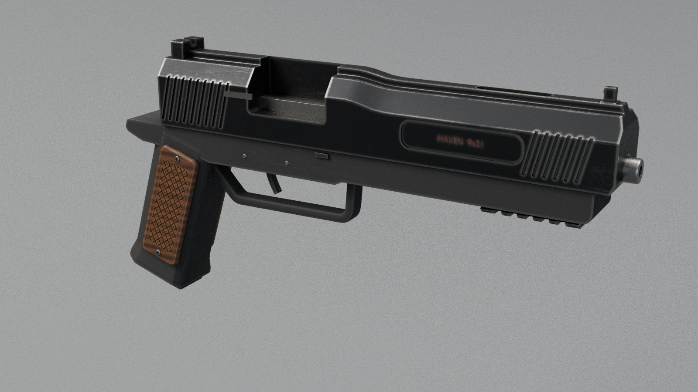
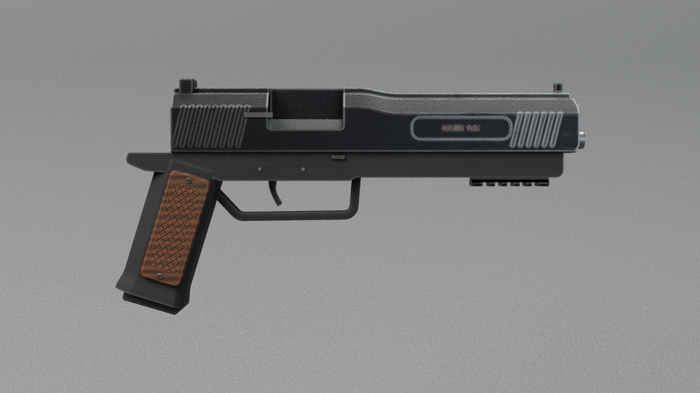
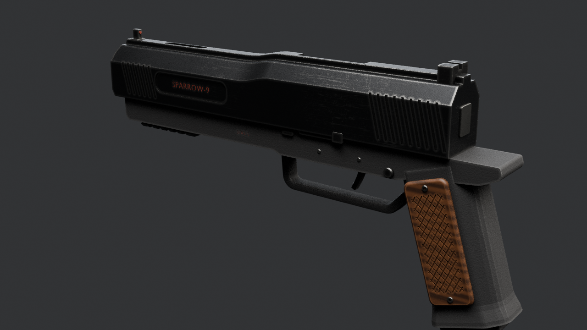

# Sparrow-9 — Roblox handoff package

> **To the Roblox coding chat:** this folder is a complete, self-describing model package from Nic's Blender pipeline. Everything you need to make the model *fully functional and realistic* in Survival Island is here: the mesh file, every moving part with its exact hinge and motion, seats, sockets, lights, collision proxies, physics data and gameplay rules. The machine-readable source of truth is `Sparrow9_Rig.json` (schema `survival-island-model/1`); this file explains it. Please read sections 3–4 before writing code.

**Sparrow-9** · category: **weapon** · 9 mm service pistol with a dark-steel slide, polymer frame and stippled grip panels

## 1. Files
| File | What |
|---|---|
| `Sparrow9.fbx` | 13 meshes, 21442 triangles (largest 6036 — under Roblox's 20k limit), already in studs |
| `Sparrow9_Rig.json` | all data below, machine-readable |
| `Sparrow9_HANDOFF.md` | this guide |
| `previews/` | renders at rest and deployed |

## 2. Import into Studio
3D Importer (Home → Import / Avatar → Import 3D / File → Import 3D / Ctrl+M) with: **Scale Unit = Stud, Scale Factor = 1, World Forward = Front, World Up = Top, Set Pivot to Scene Origin ✔, Upload to Roblox ✔**.
Expected File Dimensions ≈ **0.26 × 1.02 × 2.04** studs (X × Y × Z). The import is a flat Model of MeshParts that are all grey/white, anchored-or-unanchored, unwelded and fully collidable — your setup code must fix that (§4).
Bounding-box centre after a correct import: `(0.00, -0.25, -0.34)` — use it to re-align the model if a different pivot option was used (`shift = expected_center − actual_center`).

## 3. Coordinates, units, names
- **1 stud = 0.28 m.** All `*_studs` values in the JSON are final Roblox numbers.
- Model space: origin on the bore axis directly above the trigger (all five weapons share this datum), **front = −Z (LookVector)**, up = +Y, **the model's RIGHT = +X**, its left = −X. (Blender source: front −Y, left +X; converted for you.)
- Mesh names: `RBX_<Group>_<Material>[_n]`. `<Group>` is either `Body` (static) or a moving group from §5. Group names contain underscores, so match them against the JSON `groups` keys (longest match first); `<Material>` has no digits; `_n` is a chunk index for big meshes.
- Every moving group's meshes were exported with the MeshPart pivot on the group's hinge, but Roblox recentres MeshParts — always use `pivot_studs` from the JSON, never the MeshPart position.

## 4. Recommended assembly (Roblox `Tool`)
1. Put every MeshPart in a **`Tool`**. Add an invisible, unanchored **`Handle`** part (about 0.4 × 0.4 × 0.4 studs, `CanCollide = false`) centred on point `SP9_Grip_Right` (§8). Set `Tool.Grip` so that point sits in the character's right hand. The weapon then points along the HumanoidRootPart LookVector, because the muzzle is −Z.
2. Static meshes (`RBX_Body_*`): `WeldConstraint` to the Handle. Visual parts: `CanCollide = CanTouch = CanQuery = false`, `Massless = true`, materials from §11 (or the SurfaceAppearance of §15).
3. **One Motor6D per moving group** (§5): Part0 = the parent group's joint (or the Handle for `parent_group = Body`), Part1 = an invisible joint part at `pivot_studs` (identity rotation); weld the group's meshes to that joint part. Create parents first (e.g. a bolt before its handle).
4. Animate on the client with `Motor6D.Transform` (`rotate` → `CFrame.fromAxisAngle(axis, math.rad(open * eased_progress))`, `translate` → `CFrame.new(axis * studs * eased_progress)`). Use the channels in §6: play `Cycle` 0→1→0 once per shot at the `rpm` of §12, `Trigger` while the button is held, `Reload` / `Charge` / covers in the order given in the channel rules. The server owns ammo, fire rate and hit detection.
5. Attachments at the points of §8: `Muzzle` (raycast origin + direction, flash, smoke), `Ejection` (shell casing emitter, direction given), `Aim` (camera position for aiming down sights), `Grip_Left` (support hand IK target), `MagWell` (where a new magazine enters).
6. Hide / show a group (e.g. the magazine during reload) by setting `LocalTransparencyModifier` on its meshes; groups of `kind = store` are meant to be hidden and shown like that.

## 5. Moving parts
Axes are the joint frame (= model axes at rest). An axis is a letter (X / Y / Z) or a unit vector `(x, y, z)` in model space for hinges that are not on a model axis — rotate about it with `CFrame.fromAxisAngle(axis, math.rad(angle))`. `open` is the value at channel state 1; `stage` is the slice of the channel's 0→1 progress during which this part moves (ease each slice with smoothstep). Types: rotate / translate (channel-driven), aim_yaw / aim_pitch / steer / control (player input, clamp to min..max), spin (continuous while its channel > 0), wheel (rolls on the ground), fixed (rides on its parent; `store` = a weapon that can be hidden / released).

| Group | Parent | Pivot (studs) | Motion | Channel · stage | What it is |
|---|---|---|---|---|---|
| `SP9_Magazine` | Body | (-0.00, -0.28, 0.40) | slide +0.6429 studs along (-0.000, -0.956, 0.295) | Reload · 0–0.45 | magazine: drops out of the grip along the grip axis (0.18 m) |
| `SP9_Slide` | Body | (-0.00, 0.07, -1.32) | slide +0.2857 studs along Z | Cycle · 0–1 | slide: recoils 0.080 m rearward and returns once per shot (locks back on an empty magazine) |
| `SP9_Trigger` | Body | (-0.00, -0.13, -0.01) | rotate -12 deg about X | Trigger · 0–1 | trigger (with safety blade): 12 deg rearward to fire |

## 6. Channels (states the server owns)
| Channel | Duration 0→1 | Moves | Rules |
|---|---|---|---|
| `Trigger` | 0.04 s | `SP9_Trigger` | — |
| `Cycle` | 0.04 s | `SP9_Slide` | — |
| `Reload` | 0.60 s | `SP9_Magazine` | — |

## 6b. Named poses (flight modes / test states)
| Pose | Channels at 1 | Inputs | On the ground | What it is |
|---|---|---|---|---|
| `fire` | Trigger=1, Cycle=1 | — | no | trigger pulled, slide fully back |
| `reload` | Reload=1, Cycle=1 | — | no | slide locked back, magazine out |

## 8. Points / sockets
| Point | Position (studs) | Attached to | Purpose |
|---|---|---|---|
| `SP9_Muzzle` | (-0.00, 0.00, -1.36) | Body | muzzle (direction=[-0.0, 0.0, -1.0], note=bullet origin + muzzle flash) |
| `SP9_Ejection` | (0.08, 0.18, -0.14) | Body | ejection (direction=[0.6217, 0.742, 0.2507], note=spent cases leave the port up and to the right) |
| `SP9_Grip_Right` | (-0.00, -0.39, 0.40) | Body | grip_right (note=firing hand on the grip (RightGripAttachment)) |
| `SP9_Grip_Left` | (-0.00, -0.48, 0.42) | Body | grip_left (note=support hand wraps the firing hand (two-hand hold)) |
| `SP9_Aim` | (-0.00, 0.25, 0.68) | Body | aim_eye (direction=[-0.0, 0.0, -1.0], note=eye position on the notch / post sight line) |
| `SP9_MagWell` | (-0.00, -0.69, 0.53) | Body | magwell (direction=[-0.0, -0.9555, 0.2949]) |

## 11. Materials (apply by the `<Material>` part of each mesh name)
| Material | Roblox material | Colour (RGB) | Transparency | Reflectance |
|---|---|---|---|---|
| Blackened | Metal | 38, 38, 40 | 0 | 0 |
| DarkSteel | Metal | 52, 53, 56 | 0 | 0 |
| MarkRed | SmoothPlastic | 118, 50, 38 | 0 | 0 |
| PolyBlack | Plastic | 34, 34, 36 | 0 | 0 |
| Steel | Metal | 128, 128, 125 | 0 | 0 |
| Walnut | Wood | 84, 52, 34 | 0 | 0 |

## 12. Gameplay systems
### Weapon
- **kind:** pistol
- **caliber:** 9x21 mm (fictional)
- **magazine:** 17
- **fire modes:** ['SEMI']
- **rpm:** 420
- **muzzle velocity mps:** 370
- **effective range studs:** 214
- **reload s:** 1.5
- **damage hint:** low-medium
- **recoil hint:** snappy muzzle flip
- **aim:** notch rear sight + post front sight (faded red insert)
- **ammo item:** Ammo_9x21
- **holster:** hip

## 13. Notes and rules
- Weapon origin = bore axis above the trigger; the muzzle points -Z in Roblox (LookVector).

## 14. Acceptance checklist (test in Studio before calling it done)
- [ ] Import size matches §2; installer reports 0 unknown mesh names.
- [ ] Every group in §5 moves about the right hinge, in the right direction, by the listed amount, in stage order.
- [ ] Nothing floats or clips at rest **and** fully deployed (the Blender checks found 0 floating parts in both).
- [ ] All server checks in place (who may use what, rate limits, clamped inputs) — the game is server-authoritative.
- [ ] Output window clean (no errors/warnings from the new scripts).

_Generated 2026-10-15 17:08 by the handoff exporter (`blender/common/handoff.py`). FBX re-import check: PASSED (3 pivots compared, 0 problems)._

## 15. Baked texture atlas (optional, recommended)
All meshes of this weapon share ONE UV layout, so one `SurfaceAppearance` (cloned into every MeshPart) gives the worn, weathered look from the Blender renders (edge wear, scratches, grime, dark recesses, red markings):

| Map | File | Colour space |
|---|---|---|
| ColorMap | `textures/Sparrow9_BaseColor.png` | sRGB |
| RoughnessMap | `textures/Sparrow9_Roughness.png` | linear |
| MetalnessMap | `textures/Sparrow9_Metalness.png` | linear |

Upload the three PNGs (Asset Manager > Bulk Import), create a SurfaceAppearance with the three IDs, and parent a clone to each MeshPart. With a SurfaceAppearance the MeshPart `Color` is ignored; without it, use the flat colours of section 11.

## 16. Previews
  

Pose previews (moving parts deployed): `previews/Sparrow9_pose_*.png`.
